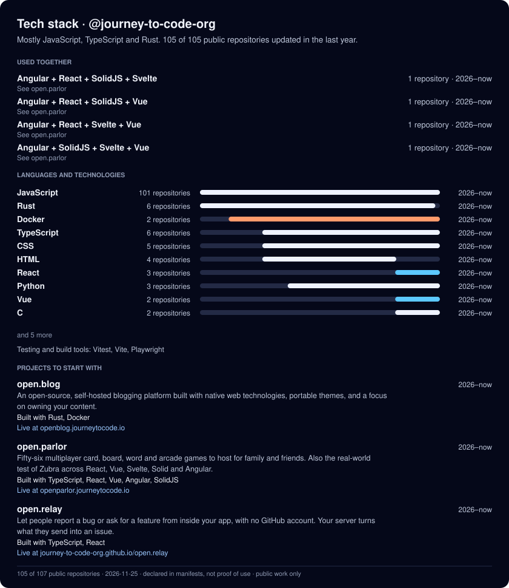

<a href="https://journeytocode.io/"></a>

Open-source tools, games and learning projects that I build in the open, meant to be owned by the people who use them. Most of it is my own work, with some welcome contributions from others.

**[journeytocode.io](https://journeytocode.io/)** is my blog and home base. It runs on [open.blog](https://github.com/journey-to-code-org/open.blog), the platform I built for it.

---

## Featured: open.blog

<a href="https://github.com/journey-to-code-org/open.blog"></a>

### [open.blog](https://github.com/journey-to-code-org/open.blog) · Rust · GPL-3.0

An open-source, self-hosted blogging platform built with native web technologies, portable themes, and a focus on **owning your content**. It's the engine behind journeytocode.io, so I use it every day.

- **Markdown in, static site out.** Posts are plain `.md` files in a folder. No database.
- **Themes are design tokens.** A theme is a JSON file that compiles to CSS custom properties. Themes can inherit from each other, and each series can have its own.
- **Works without JavaScript.** Small web components add search, dark mode, syntax highlighting and view counts on top.
- **Studio.** A sign-in protected, writing-first editor that works on a phone and offline, with a "before you publish" checklist, scheduling and drafts that save themselves.
- **Built in:** RSS, JSON Feed, sitemap, Open Graph, cookie-free analytics, recipe and research post types, and Hashnode import.
- **Publish from home.** A Publish button commits and pushes with git, and GitHub Pages deploys it.

```sh
cargo install --git https://github.com/journey-to-code-org/open.blog openblog-cli
```

[Documentation](https://journey-to-code-org.github.io/open.blog/) · [Live demo](http://openblog.journeytocode.io/)

---

## Writing: Journey to Code

I write at **[journeytocode.io](https://journeytocode.io/)** about what I'm building and learning: JavaScript, Web Components, Git, Rust and WebAssembly, and application architecture. Several of the projects below started as a series there.

### Featured series

- **[Commit to Success: Mastering Git](https://journeytocode.io/series/learn-git-from-basics-to-advanced)**: moving beyond basic commands to master version control, branches, merging, and real-world collaboration.
- **[Journey to Web Components](https://journeytocode.io/series/web-components-fundamentals-to-advanced)**: reusable UI architecture without heavy frameworks, using Custom Elements, Shadow DOM, and native browser APIs.
- **[Mastering the Fetch API & Browser Storage](https://journeytocode.io/series/mastering-fetch-api-browser-storage)**: network requests, client-side persistence (IndexedDB, Cache API), and resilient offline-first design.
- **[Mastering the Web Audio API](https://journeytocode.io/series/complete-web-audio-api-tutorial)**: creative coding, spatial audio, synthesis, and processing directly in the browser.
- **[Coding Patterns Demystified](https://journeytocode.io/coding-patterns-demystified)**: a deep dive into the Model-View-Controller pattern with shipping code.

### Recent articles

<!-- BLOG-POST-LIST:START -->
- [One Message Is Not a Conversation](https://journeytocode.io/one-message-is-not-a-conversation/) — Keep a Rust TCP client and server talking until quit, using loop, break, continue and the zero-byte read that means the...
- [The Input That Never Got Submitted](https://journeytocode.io/a-custom-input-that-joins-the-form/) — Build a custom form field the browser actually submits, resets and blocks on bad input, using formAssociated and Element...
- [A Server With Nobody to Talk To](https://journeytocode.io/a-server-with-nobody-to-talk-to/) — Build a Rust TCP server and client, send one welcome message across localhost and let Result and the question-mark opera...
- [The File That Exists Twice](https://journeytocode.io/the-file-that-exists-twice/) — Our practicum team never fixed a merge conflict that kept coming back. The cause was one file with two names in Git. See...
- [The Tutorial Is Not the Game.](https://journeytocode.io/the-tutorial-is-not-the-game/) — Turn a finished Rust tutorial into a welcoming open-source project, then take one small contribution from idea to pull r...<!-- BLOG-POST-LIST:END -->

*This list updates itself from the [blog's feed](https://journeytocode.io/rss.xml) every few hours.*

---

## The family game room: open.parlor and friends

<a href="https://github.com/journey-to-code-org/open.parlor"></a>

### [open.parlor](https://github.com/journey-to-code-org/open.parlor) · TypeScript

A family games site with **fifty-six card, board, word and arcade games**, houses, tournaments and computer players. It began as Spades for a grandmother's blog, and it gets played.

It's also the production test for [Zubra](https://github.com/zubra-js/zubra), a compiler that turns one component into a custom element any framework can use. The parlor runs one set of Zubra components from **React, Vue, Svelte, Solid and Angular** at once, against one real server, and checks them with a 214-check conformance suite in Chrome, Firefox and WebKit.

[Play it](https://openparlor.journeytocode.io/)

The parlor is assembled from reusable pieces, and each one works on its own:

| Project | What it does |
| --- | --- |
| [**open.games**](https://github.com/journey-to-code-org/open.games) | The game engine and kit. A game is a set of pure functions over plain data, so it runs the same in a browser, on a server or in a worker. Includes card, board and table-sport kits, deterministic 2D physics, and computer players. [Docs](https://journey-to-code-org.github.io/open.games/) |
| [**open.rooms**](https://github.com/journey-to-code-org/open.rooms) | Realtime multiplayer rooms, houses, lobbies and tournaments for turn-based games. The server decides every move, each seat sees a private view, empty seats fill with bots, and a move log lets a room be replayed or resumed after a restart. [Docs](https://journey-to-code-org.github.io/open.rooms/) |
| [**open.chat**](https://github.com/journey-to-code-org/open.chat) | A chat for any app. Only the server changes a room, so every message is checked first. It has polls, message take-down, an optional word filter, unread counts, and notices for members who aren't looking. |

---

## Built to be reused

| Project | What it does | Stack |
| --- | --- | --- |
| [**open.relay**](https://github.com/journey-to-code-org/open.relay) | Lets people report a bug or ask for a feature from inside your app, with no GitHub account. Your server turns it into an issue. People choose whether to share a screenshot and browser details, and can review a tidied report before sending. Asking for something that was already requested adds a vote to the existing issue. [Docs](https://journey-to-code-org.github.io/open.relay/) | TypeScript |
| [**symbology**](https://github.com/journey-to-code-org/symbology) | QR codes and barcodes (Code 128, Code 39, EAN-13) from scratch with no dependencies. It encodes, and decodes from a camera frame. It also ships as WebAssembly with a JavaScript API. [Try it](https://journey-to-code-org.github.io/symbology/) | Rust |
| [**signals-devtools**](https://github.com/journey-to-code-org/signals-devtools) | Developer tools for the TC39 Signals proposal. A no-install playground shows the dependency graph updating as your code runs, and a browser extension inspects every signal on a page. [Playground](https://journey-to-code-org.github.io/signals-devtools/) | JavaScript |
| [**release-on-bump**](https://github.com/journey-to-code-org/release-on-bump) | A GitHub Action. Bump a version in a PR, merge it, and every package whose version isn't on npm yet is published in dependency order with provenance and no stored npm token. Then it tags and releases each one. | JavaScript |
| [**open-suite**](https://github.com/journey-to-code-org/open-suite) | One install for **72 small, dependency-free utilities** (the `open.*` packages): arrays, dates, text, validation, HTTP helpers, terminal tools and more. | JavaScript |

---

## Experiments

- [**wasm-toolkit**](https://github.com/journey-to-code-org/wasm-toolkit) is a tiny C toolkit for games that look and run like 1989. It has a 320×240 palette screen, a PC speaker, and no libc, floats or allocation, and it builds to WebAssembly with clang alone. It includes its first game, *Road to the Shootout*, a street-racing and garage game in the spirit of Street Rod and Test Drive.
- [**open.cms**](https://github.com/journey-to-code-org/open.cms) *(early)* is a place-based CMS and static publishing engine for regional guides, trails and maps, with Rust/WASM GPX analysis. It's growing out of a real regional adventure guide, and the 0.1.x releases lay down the site-package format.
- [**open.quiz**](https://github.com/journey-to-code-org/open.quiz) is a full-stack learning platform (Node, Express, React, MongoDB) with lessons, quizzes, XP, badges and leaderboards. It supports importable `.openquiz.json` content and theme packages and has an admin area. It's forked from Team 2 of Code the Dream's Summer 2026 practicum.

---

## Learn by building

- [**rustbound-idle**](https://github.com/journey-to-code-org/rustbound-idle) is a community-built Rust and WebAssembly idle game from the [Rustbound series](https://journeytocode.io/series/rustbound-build-your-first-rust-app/).
- [**one-world-many-players**](https://github.com/journey-to-code-org/one-world-many-players) is the companion server for [Rustbound II](https://journeytocode.io/series/one-world-many-players/). Build a multiplayer text world in Rust.
- [**scam-mirror**](https://github.com/journey-to-code-org/scam-mirror) is a privacy-first cybersecurity simulator. You land inside one of five fictional scams, such as a fake job offer, credential phishing or a booby-trapped coding challenge. You get a supportive debrief on the pressure tactics used, and nothing leaves your browser. [Try it](http://careers.journeytocode.io/)

---

## Tech stack constellation

The languages, frameworks and tools declared across every repository in this organization, with lines joining the ones used together. It's redrawn every day with [Constellation](https://github.com/mnichols08/constellation), and **its look and motion change daily**: the sky, glow and effects shift, and different parts of it move, always in the blog's black and yellow.

<p align="center">
  <a href="https://mnichols08.github.io/constellation/?organization=journey-to-code-org">
    
  </a>
</p>

*A technology counts when a repository declares it, which doesn't prove how well it's used.*

---

## Get involved

- Read the blog at [journeytocode.io](https://journeytocode.io/)
- Browse the [repositories](https://github.com/orgs/journey-to-code-org/repositories)
- Open an issue or pull request on any project. Beginners are welcome.
